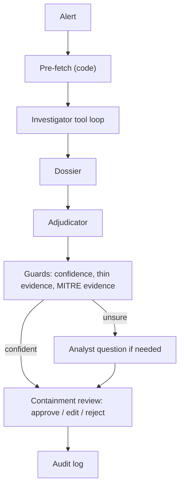

# PROJECT_BRIEF: ITDR Identity Incident Builder

**Status (2026-10-21): complete.** All nine sections are written; the evaluation numbers are final (30 of 30 runs, `eval/final/results.md`, section 7) and section 8 carries Joe's manual baseline. Sections follow PLAN.md ("PROJECT_BRIEF.md (After Checkpoint 7)"). Code changes after the evaluation (the thin-evidence guard, the Dream Run 1 fixes, the 2026-10-21 review fixes) are noted where they touch a claim; the headline numbers are not re-scored until the next full evaluation.

## 1. Problem

Identity is where most attacks start. Microsoft reports that more than 97% of identity attacks are password attacks, and that identity-based attacks rose 32% in the first half of 2025 [M1]. In Microsoft Entra ID, a risky sign-in alert is often the first sign [M2].

The alert alone doesn't answer the analyst's real question: is this account compromised? To answer it, an analyst has to pull the user's profile, recent sign-in history, the device, and directory audit activity like role changes and app consents, then line them up in time [M2]. Many alerts turn out benign: real travel, a company VPN, an approved admin change. Those look-alikes are built into this project's test set on purpose [F1]. Microsoft describes analysts as "often overwhelmed by the sheer volume of alerts" [M4]. Every alert still needs a decision, containment steps, and a way to undo them if the call was wrong.

## 2. Target users

- **Who:** security operations and identity analysts who triage Entra ID risky sign-in alerts, especially at organizations that don't have Microsoft's premium AI tooling. Microsoft's own triage agents require Security Copilot capacity (SCUs) and, for identity risk, Entra ID P2 [M3, M4, M5].
- **What they need:** a fast, evidence-backed first answer (verdict, confidence, the MITRE ATT&CK technique and the record that proves it), containment steps that each come with a rollback, and a written record of what was decided and by whom.
- **What motivates them:** clearing the queue faster, catching real compromises, not locking out a traveling employee by mistake, and keeping a clean audit trail.

## 3. Why this is an agentic AI problem

- **The evidence needed changes with the alert.** Impossible travel needs sign-in locations and devices; MFA fatigue needs the timing of MFA denials; a malicious app consent needs the audit log in order after a risky sign-in; an unknown user should stop early [P2, C5]. A fixed script either pulls everything every time or misses what a given alert needs.
- **A single LLM call has no data.** It can't look anything up, so it would guess. Code first pulls the profile and seven days of sign-ins and directory audits (three Graph calls, since Dream Run 1), then the Investigator decides which of five simulated Graph tools to call, one step at a time, up to 8 calls of its own, with a retry on errors [C6].
- **Judgment and control are split.** The model reasons; code enforces the rules: MITRE claims must match evidence [T5], low confidence becomes INSUFFICIENT_DATA [C3], and a critical data gap skips the model entirely [C5].
- **It knows when to ask.** On a low-confidence or INSUFFICIENT_DATA verdict, it asks the analyst one targeted question and re-checks once [C5]. A person approves, edits, or rejects every containment step [C5].

## 4. Definition of Done

| Item | Definition |
|---|---|
| Primary users | Security operations and identity analysts triaging Entra ID risky sign-in alerts (section 2). |
| Core problem | Turning one risky sign-in alert into a verdict, evidence, and reversible containment, quickly and accurately (section 1). |
| Agent behaviour | Investigator gathers evidence with tools (3 pre-fetched by code, then up to 8 of its own) [C6]; MITRE techniques are derived in code with the evidence ids [T3]; Adjudicator returns a structured report [C2]; orchestrator applies governance, asks the analyst when unsure, and runs the containment review [C5]. |
| Inputs | One synthetic Entra ID alert, filtered to an allowlist of Graph-shaped fields and wrapped as untrusted data [T2, T4]. |
| Outputs | Incident report: verdict (COMPROMISED, SUSPICIOUS, FALSE_POSITIVE, INSUFFICIENT_DATA), confidence, narrative, MITRE techniques, containment steps each with a rollback, recommended actions, audit notes [C7]; plus one audit log line per event [C5]. |
| Constraints | Synthetic data only [A1]; free model [E1]; 120 seconds of machine time per run [C4]; the agent executes nothing, it only recommends [C2]; all data treated as untrusted [T4]. |
| Human decision points | (1) One question when the verdict is INSUFFICIENT_DATA or confidence is below 0.70, then at most one re-check; (2) approve, edit, or reject each containment step [C5]. |
| Success criteria | Measured against ground truth for 10 alerts × 3 runs: exact verdict accuracy (primary), attack-vs-benign detection, false positives, MITRE precision and recall, run-to-run agreement, time, and requests [P7, E1]. Final numbers are in section 7 and `eval/final/results.md`. |

## 5. Flow diagram

`Alert → Understand goal → Gather context (tools) → Plan → Evaluate results → Ask the analyst if needed → Draft containment + rollback → Analyst approves → Report`

| Step | Where it happens |
|---|---|
| Alert | `data/fixtures/alerts.jsonl`, filtered and wrapped (`investigator.build_alert_prompt`) |
| Understand goal | Investigator system prompt (`investigator.build_system_prompt`) |
| Gather context (tools) | Investigator loop and the 5 tools (`investigator.py`, `tools.py`, `sim_api.py`) |
| Plan | The Investigator picks its next tool each turn from what it has seen so far |
| Evaluate results | Evidence → indicators and MITRE in code (`derive_indicators`), then the Adjudicator's verdict with the confidence and MITRE guards (`adjudicator.py`) |
| Ask the analyst if needed | `Orchestrator._ask_and_maybe_readjudicate` |
| Draft containment + rollback | Adjudicator report: every step carries a rollback (`schemas.ContainmentStep`) |
| Analyst approves | `Orchestrator._review_containment` (approve / edit / reject) |
| Report | Final report + `logs/audit.jsonl` |

## 6. Comparison

| | **This project (ITDR Identity Incident Builder)** | **Microsoft Entra ID Protection** | **Identity Risk Management Agent (Security Copilot, preview)** | **Microsoft Purview DLP Triage Agent (Security Copilot)** |
|---|---|---|---|---|
| **Coverage** | One Entra ID risky sign-in alert at a time: identity compromise (5 attack patterns, 3 benign look-alikes) [F1] | Detects identity risks (for example anonymous IP, password spray, leaked credentials) and scores sign-ins and users [M2] | Investigates risky users in Entra ID Protection; user identities only, up to 100 risky users per run [M4] | Data loss prevention alerts from Exchange, Teams, OneDrive, SharePoint, and devices; not identity [M5] |
| **Inputs** | Synthetic alert; simulated Graph profile, sign-ins, device, directory audits, risky-user report [C1, C6] | Real tenant signals ("trillions of signals each day") [M2] | Real tenant sign-in logs, risk detections, risky users, audit logs [M4] | Real DLP alerts and the matched content (up to the top 10 files per alert) [M5] |
| **Human oversight** | Analyst answers one question when unsure; approves, edits, or rejects every containment step; nothing is executed [C5, C2] | Automatic remediation through risk-based Conditional Access, or manual review by an admin [M2] | Suggestions need manual admin approval; automatic remediation isn't supported [M4] | Analyst can re-categorize alerts and give feedback; optional Teams reminders to users (preview) [M5] |
| **Outputs** | Verdict, confidence, narrative, MITRE techniques with evidence, containment + rollback, audit log [C7, C5] | Risk detections, risky sign-ins and risky users reports; risk levels feed Conditional Access [M2] | Risk summary, findings, a recommended remediation action, chat [M4] | "Needs attention" / "Less urgent" queue with a summary and risk factors [M5] |
| **Limits** | Synthetic data, free model, small evaluation (section 7) | Full features need Entra ID P2 [M2] | Preview; needs Entra ID P2 and Security Copilot SCUs; AI summaries "might be incomplete or incorrect" [M4] | Needs Security Copilot onboarding and SCUs; doesn't triage simulation-mode policies; files up to 2 MB [M5] |

What this project adds next to them: it works without premium licenses, writes containment with a rollback for every step, ties every MITRE claim to the record that proves it, and was evaluated against labeled ground truth, with its limits stated in section 7. What it lacks is everything a real product has: real data, scale, and support.

## 7. Limits and risks

The numbers below come from the full evaluation: 30 of 30 runs, 0 failed, run from October 12 to 15, 2026 on two free accounts (Joe's 15 and his partner's 15), combined into one report [E1].

### 7.1 Synthetic data, no real tenant

- **Everything is synthetic.** The corpus is 10 alerts (5 attacks, 3 benign look-alikes, 1 thin-data, 1 unknown user), 30 users, 133 sign-ins, and 53 directory audits, generated from a fixed seed [F1]. No real logs, users, or tenant data were used at any point [A1].
- **Microsoft Graph is simulated.** The agent calls a local stand-in for Graph [C1]. Field names were checked against Microsoft Learn and are locked by an allowlist test [T1], and one field we rely on (`networkLocationDetails`) exists only in the Graph beta API [P1]. A real tenant adds things this project never exercised: paging, throttling, missing or renamed fields, and far more noise.
- **The same team wrote the data and the detection logic.** The MITRE mapping in code was built against the same five attack patterns the generator plants [P2]. That risks measuring how well the agent matches its own data. What we did: the answer key (`ground_truth.jsonl`) never reaches the model [T2], each attack has a benign look-alike, and every technique must point to the exact sign-in or audit record that proves it [T3]. It is still not an independent test set.
- **The test IP ranges leaked into the model's reasoning.** The benign look-alikes sign in from documentation ranges (203.0.113.x, TEST-NET-3), while the attacks use real-world ranges. In all 3 ALERT_006 runs called FALSE_POSITIVE, the narrative gave the TEST-NET range ("synthetic or test data") as a reason the sign-in was benign [E1, E3]. On real data that shortcut would wave attacks through. Since `044ae3c`, the prompt says an IP's address range is never evidence on its own, and a code check flags any report that leans on one (it flags exactly those 3 saved runs and no others) [P12]. It has not been re-evaluated live yet.

### 7.2 Free-model variability and reproducibility

- **The same alert can get a different answer.** At temperature 0, ALERT_006 (benign travel) came back INSUFFICIENT_DATA (confidence 0.55), then FALSE_POSITIVE (0.90), then FALSE_POSITIVE (0.70). ALERT_004 (app consent) came back SUSPICIOUS (0.78), SUSPICIOUS (0.72), then COMPROMISED (0.88). Multi-run agreement is 93.3% [E1].
- **The evaluated model is not the one first verified.** Checkpoint 5 was verified on Gemma 4 31B (free). Gemma was rate-limited by its provider on both smoke-test attempts, so the evaluation runs on Nemotron 3 Super (free) [P3]. OpenRouter documents that a 429 can come from the upstream provider [X1]. Free models can change or disappear, so these results may not be reproducible later.
- **One model only.** No other model was evaluated, so there is no comparison across models.
- **The code changed during the evaluation.** Three changes landed mid-evaluation: a total timeout and an action-claim guard (commit `d0d6b15`), an unsafe-rollback guard (commit `1a83ccb`), and an 8,192-token output cap on every model call (commit `7fefa50`) [P4, P9]. At least 18 of the 30 runs used the code from before `d0d6b15`: Joe's 12 runs of ALERT_001, 002, 003, and 006, and the partner's 6 runs of ALERT_004 and 005, which ran before the fix existed [E1]. Joe's 3 ALERT_009 runs used both guards but not the output cap. The run records don't store the code version, so for the partner's 9 later runs (ALERT_007, 008, 010) the newer code applies only if the partner pulled first. None of these changes alters how a verdict is decided, but the prompt gained two rules ("You only recommend…" and never restoring an old password or MFA setup in a rollback), which could change the model's wording [C2]. No run took longer than 83 seconds, so the 120-second limit never decided a result [E1].

### 7.3 Prompt injection

- **What's in place.** The alert, every tool result, the dossier, and the analyst's answers are wrapped as untrusted data, with `<` and `>` escaped so a record cannot close its own data block. Tests try to break out of the wrapper and to slip instructions into the data [T4]. MITRE technique claims are checked in code against the evidence, not trusted from the model [T5].
- **What's not.** Wrapping and escaping lower the risk; they don't remove it. A model can still be misled by text inside the data, and the project has no red-team testing beyond the probes in the test suite.

### 7.4 False positives and missed attacks

- **False positives:** 0 of 9 benign runs were called COMPROMISED or SUSPICIOUS. One benign run (ALERT_006) fell back to INSUFFICIENT_DATA instead of FALSE_POSITIVE [E1].
- **Attacks:** all 15 attack runs were flagged as COMPROMISED or SUSPICIOUS, so none was missed outright. 13 of 15 got the exact verdict with the correct MITRE technique. The 2 misses were ALERT_004 (app consent): the Investigator didn't gather the consent record, so the model said SUSPICIOUS and named no technique. In the third run it did gather it and said COMPROMISED with T1528 [E1].
- **Confidently wrong on thin data.** ALERT_009 (a known user with 2 sign-ins and no audits; expected INSUFFICIENT_DATA) came back FALSE_POSITIVE at 0.90 to 0.92 in all 3 runs. The model read missing evidence as proof that nothing happened, so the 0.70 guardrail never fired and the analyst was never asked [E1, P10]. In a real SOC that closes a case nobody actually checked. **After the evaluation** a code guard was added: a FALSE_POSITIVE with fewer than 3 sign-ins and no audits in the user's last 7 days becomes INSUFFICIENT_DATA, so the analyst is asked. The first version counted only what the Investigator fetched, and on the benign VPN alert (6 sign-ins, 2 fetched) it overrode a correct FALSE_POSITIVE; the guard now counts the 7 days itself [P10, P11]. In the after-fix check (1 run per alert, all 10 alerts) ALERT_009 came back INSUFFICIENT_DATA and all 10 were correct [E3]. One run each shows the fix works; it does not replace the 30-run numbers above.
- **MITRE:** precision 100% (15 correct, 0 wrong), recall 83.3% (3 missed: the two ALERT_004 runs and one ALERT_007 run) [E1].
- **Why that fallback happens.** Any verdict below 0.70 confidence is turned into INSUFFICIENT_DATA in code [C3]. That sends uncertain cases to the analyst instead of making a wrong call, but it costs analyst time.
- **Small sample.** Ten alerts, three runs each, split across two people [P5]. The false-positive rate on real alert volume is unknown.

### 7.5 Human oversight: what the numbers don't show

- **The ask-the-analyst path is never measured.** During scoring, a scripted reviewer approves every containment step and cancels every question, so the one-question re-check never runs. The numbers show the agent alone [E2].
- **The model claimed actions it never took.** In the first live run, the model wrote "Containment steps executed as per playbook" [P3]. The agent executes nothing: it recommends steps, and a person approves them. Since `d0d6b15`, the prompt forbids that wording and a code check flags it in the report and the audit log [T6]. The check matches patterns, so it can miss a reworded claim. An analyst still has to read the report.
- **The model proposed an unsafe rollback.** In a live run on ALERT_001, a password-reset step's rollback was "temporarily revert the password to its previous value", which would hand back the password the attacker used [P8]. The schema only required that a rollback exist. Since `1a83ccb`, the prompt forbids restoring an old password or MFA setup, and a code check flags such a rollback, warns the analyst on that step, and logs it [T7]. It also matches patterns, so the analyst's review is still the real safeguard.

### 7.6 Cost and latency

- **Model cost: $0.** The evaluation uses a free model on OpenRouter. Free models are limited to 20 requests a minute and 50 a day, or 1,000 a day after buying at least 10 credits [X1].
- **Per run:** 44.3 seconds on average (26.4 to 82.1), about 6.4 model requests (192 over 30 runs), and about 9,600 tokens in and 2,600 out [E1].
- **The free tier makes evaluation slow.** With a 45-request daily budget and room for a 10-request worst case reserved before every run, 30 runs on one account take about six days [P6]. The dry run estimated five days, worst case eight [P6]. Splitting the runs across two accounts finished them in four UTC days [E1].
- **A run has 120 seconds of machine time.** Runs that go over are stopped and scored as failed; time an analyst spends answering does not count [C4].
- **No paid-model estimate.** Cost on a paid model was not measured.
- **Time saved versus a person:** see section 8, which needs Joe's manual baseline.

### Citations (section 7)

- **[E1]** `eval/final/results.md` and `eval/final/raw.jsonl` (Headline metrics, Per alert, Per run, Failure table), commit `0924fc3`; combined from `eval/` (Joe) and `eval/partner/` (partner, PR #1, merge `33c00f8`).
- **[E2]** `eval/final/results.md`, Method: "a scripted reviewer approves every containment step and cancels every `ask_user` question."
- **[F1]** `data/fixtures/` (`alerts.jsonl` 10, `users.jsonl` 30, `sign_ins.jsonl` 133, `directory_audits.jsonl` 53, `ground_truth.jsonl` 10); `itdr_agent/data_generator.py`.
- **[A1]** `AGENTS.md`, Standing Rule 1 ("Synthetic data only").
- **[C1]** `itdr_agent/sim_api.py`, `itdr_agent/fixture_store.py`.
- **[C2]** `itdr_agent/adjudicator.py` (`SYSTEM_PROMPT`, `apply_action_claim_guard`); `git diff 3c65367 d0d6b15`.
- **[C3]** `itdr_agent/schemas.py`, `apply_confidence_guardrail` (`CONFIDENCE_THRESHOLD = 0.7`).
- **[C4]** `itdr_agent/orchestrator.py` (total timeout, analyst time excluded); `itdr_agent/config.py` (`TIMEOUT_SECONDS`, default 120).
- **[T1]** `tests/test_graph_fields.py`.
- **[T2]** `tests/test_investigator.py::test_no_answer_key_in_any_alert_prompt`; PROGRESS.md decision "Ground truth in `data/fixtures/ground_truth.jsonl`".
- **[T3]** `mitre_attack_evidence` in `itdr_agent/investigator.py`; MITRE checklist in PROGRESS.md.
- **[T4]** `tests/test_investigator.py` (`test_tool_output_is_wrapped_as_untrusted_data`, `test_wrapper_cannot_be_broken_out_of`, `test_alert_wrapper_breakout_probe`, `test_alert_instruction_probe_stays_inside_wrapper`); `tests/test_adjudicator.py` (`test_dossier_is_wrapped_and_escaped`, `test_dossier_breakout_probe`); `tests/test_human.py::test_wrap_analyst_input_wraps_and_escapes`.
- **[T5]** `itdr_agent/adjudicator.py`, `assert_mitre_claims_supported`; `tests/test_adjudicator.py::test_mitre_claims_must_be_supported`.
- **[T6]** `tests/test_adjudicator.py` (action-claim tests), `tests/test_orchestrator.py::test_action_claim_is_logged_with_run_id`; commits `ccb1b61` / `d0d6b15`.
- **[T7]** `tests/test_adjudicator.py` (unsafe-rollback tests), `tests/test_orchestrator.py::test_unsafe_rollback_is_shown_to_the_reviewer_and_logged`, `tests/test_human.py::test_cli_reviewer_prints_the_rollback_warning`; commits `658dbb1` / `1a83ccb`.
- **[P1]** PROGRESS.md, "Microsoft Graph Schema Sources" (`networkLocationDetails` beta-only).
- **[P2]** PROGRESS.md, "MITRE ATT&CK Checklist".
- **[P3]** PROGRESS.md, "Eval model switched" and Open Problem 3; `eval/interruptions.jsonl`.
- **[P4]** PROGRESS.md, "Checkpoint 7 fix 2" (mid-eval effect).
- **[P5]** PROGRESS.md, Checkpoint 7 split (Joe: ALERT_001, 002, 003, 006, 009; partner: 004, 005, 007, 008, 010).
- **[P6]** PROGRESS.md, Checkpoint 7 (budget, dry run) and Open Problem 7.
- **[P8]** PROGRESS.md, "Checkpoint 7 fix 3" (the live ALERT_001 run, 2026-10-13).
- **[P9]** PROGRESS.md, max-tokens fix (`8642520` / `7fefa50`, `config.MAX_OUTPUT_TOKENS = 8192`).
- **[P10]** PROGRESS.md, Open Problem 10 ("Confidently wrong on thin data").
- **[P11]** PROGRESS.md, "Guard counts its own baseline" (problem #34; `dd730bd` / `8e5db38`); `itdr_agent/adjudicator.py` (`fetch_baseline`, `BASELINE_HOURS = 168`, `apply_thin_evidence_guard`); `tests/test_thin_evidence.py`.
- **[P12]** PROGRESS.md, "IP range is never evidence" (Dream Run 1; `02244c6` / `044ae3c`); `itdr_agent/adjudicator.py` (`apply_ip_range_guard`).
- **[E3]** `eval/after-fix/results.md` and `eval/after-fix/raw.jsonl` (10 runs, 1 per alert, 2026-10-16 to 10-18); the pre-fix rows are in `raw-old-prompt.jsonl` and `raw-pre-fix-34.jsonl`.
- **[X1]** OpenRouter, API rate limits: https://openrouter.ai/docs/api/reference/limits (checked 2026-10-13).

### Claims to verify (section 7)

| Claim | Citation |
|---|---|
| 30 of 30 runs complete, 0 failed, 2026-10-12 to 10-15, two accounts | E1 |
| Corpus: 10 alerts, 30 users, 133 sign-ins, 53 audits | F1 |
| No real data used | A1 |
| Graph is simulated | C1 |
| Field names locked by an allowlist test | T1 |
| `networkLocationDetails` is beta-only | P1 |
| Answer key never reaches the model | T2 |
| Each technique points to its evidence record | T3 |
| ALERT_006 outcomes 0.55 / 0.90 / 0.70; ALERT_004 0.78 / 0.72 / 0.88; agreement 93.3% | E1 |
| Gemma rate-limited upstream; eval on Nemotron | P3 |
| 429s can come from the upstream provider | X1 |
| At least 18 runs predate `d0d6b15`; ALERT_009 runs predate `7fefa50`; partner's later runs depend on a pull | P4, P9, E1 |
| Wrapper escaping and breakout/instruction probes | T4 |
| MITRE claims checked in code | T5 |
| 0 of 9 benign runs flagged; 15 of 15 attack runs flagged; 13 of 15 exact with correct technique | E1 |
| ALERT_009 FALSE_POSITIVE at 0.90-0.92 in all 3 runs | E1, P10 |
| Guard first counted only fetched sign-ins (ALERT_008: 2 of 6) and now counts 7 days itself | P11 |
| After-fix: 10 of 10 correct, 1 run per alert, ALERT_009 INSUFFICIENT_DATA | E3 |
| MITRE precision 100% (TP 15), recall 83.3% (FN 3) | E1 |
| Below 0.70 becomes INSUFFICIENT_DATA | C3 |
| Runs split between two people | P5 |
| Scripted reviewer cancels every question | E2 |
| Model wrote "Containment steps executed as per playbook" | P3 |
| Action-claim guard flags the wording | T6 |
| Model proposed "revert the password to its previous value" as a rollback | P8 |
| Unsafe-rollback guard flags, warns, and logs | T7 |
| Free models: 20/min, 50/day, 1,000/day with 10+ credits | X1 |
| 44.3 s average (26.4-82.1), 192 requests / 30 runs, ~9.6k in / 2.6k out tokens | E1 |
| ~6 days for 30 runs on one account; dry run 5, worst case 8; 4 UTC days on two accounts | P6, E1 |
| 120 s machine time per run, analyst time excluded | C4 |

## 8. Practical value

**The comparison.** Working one identity alert by hand (pull the user's profile, sign-in history, device, and audit records, decide, and write it up) takes Joe about 30 to 60 minutes [B1]. The agent gathers the evidence, gives a verdict, maps it to MITRE, and drafts containment with rollbacks in 44.3 seconds of machine time on average (26.4 to 82.1) [E1].

| | By hand [B1] | Agent [E1] |
|---|---|---|
| One alert | 30 to 60 minutes | about 44 seconds of machine time, plus the analyst's review |
| The 10 test alerts | 5 to 10 hours | about 7.4 minutes of machine time, plus review |

**What that comparison leaves out.**
- **The analyst still reviews every case.** A person reads the verdict and approves, edits, or rejects each containment step. That review time was not measured, because scoring used a scripted reviewer [E2]. The real saving is 30 to 60 minutes minus the review.
- **The review can't be skipped.** Exact verdict accuracy is 80%, and on thin data the agent was confidently wrong in all 3 runs (section 7.4) [E1]. An unchecked FALSE_POSITIVE closes a case that should have stayed open.
- **The by-hand time is one analyst's estimate,** not a timed study [B1].
- **Synthetic alerts are cleaner than real ones** (section 7.1).

**Where it helps.** In this evaluation every attack run was flagged and no benign run was called an attack [E1]. That makes the agent most useful as a first pass: the analyst starts from a verdict, the evidence behind it, and draft containment with rollbacks, instead of a blank ticket.

**Cost.** $0 in model fees on the free tier, about 9,600 tokens in and 2,600 out per alert [E1]. Every run now records its token use in the CLI, the GUI, and the audit log, so the cost on a paid model can be measured instead of guessed [C5].

### Citations (section 8)

- **[B1]** Joe's estimate, given 2026-10-16: 30 to 60 minutes per identity alert, from his own SOC work. Not timed.
- **[C5]** `itdr_agent/usage.py` (`TokenMeter`), `itdr_agent/orchestrator.py` (audit `run` line); commit `3f9bf8a`.
- Also used: [E1], [E2] (defined under section 7).

### Claims to verify (section 8)

| Claim | Citation |
|---|---|
| 30 to 60 minutes per identity alert by hand | B1 |
| 44.3 s average machine time (26.4-82.1); 10 alerts about 7.4 minutes | E1 |
| Analyst review time not measured (scripted reviewer) | E2 |
| 80% exact accuracy; ALERT_009 confidently wrong in all 3 runs | E1 |
| Every attack run flagged; no benign run called an attack | E1 |
| About 9,600 tokens in and 2,600 out per alert, $0 on the free tier | E1 |
| Token use recorded in CLI, GUI, and audit log | C5 |

## 9. Citations and Claims to verify

Section 7's and section 8's citations and claims are listed under each section.

### Citations (sections 1-6)

- **[M1]** Microsoft On the Issues, "Extortion and ransomware drive over half of cyberattacks" (Microsoft Digital Defense Report 2025), Oct 16, 2025: https://blogs.microsoft.com/on-the-issues/2025/10/16/mddr-2025/ (checked 2026-10-13).
- **[M2]** Microsoft Learn, "What is Microsoft Entra ID Protection?" (updated 2026-02-10): https://learn.microsoft.com/en-us/entra/id-protection/overview-identity-protection
- **[M3]** Microsoft Learn, "Microsoft Entra Agents" (updated 2026-06-15): https://learn.microsoft.com/en-us/entra/security-copilot/entra-agents
- **[M4]** Microsoft Learn, "Identity Risk Management Agent" (updated 2026-05-01): https://learn.microsoft.com/en-us/entra/id-protection/identity-risk-management-agent-get-started
- **[M5]** Microsoft Learn, "Get started with the Microsoft Purview Triage Agent in Data Loss Prevention" (updated 2026-06-25): https://learn.microsoft.com/en-us/purview/copilot-in-purview-triage-dlp-agent-get-started
- **[C5]** `itdr_agent/orchestrator.py` (critical-gap short-circuit, one question + one re-adjudication, containment review, audit log); `tests/test_orchestrator.py`.
- **[C6]** `itdr_agent/investigator.py` (`MAX_TOOL_CALLS = 8`, retry once, tool loop); `itdr_agent/tools.py`.
- **[C7]** `itdr_agent/schemas.py` (`AdjudicatorOutput`, `Verdict`, `ContainmentStep`).
- **[P7]** PLAN.md, Checkpoint 7 metrics.
- Also used: [A1], [C1]-[C4], [E1], [F1], [P2], [T2]-[T5] (defined under section 7).

### Claims to verify (sections 1-6)

| Claim | Citation |
|---|---|
| >97% of identity attacks are password attacks; identity-based attacks +32% in H1 2025 | M1 |
| ID Protection detects anonymous IP, password spray, leaked credentials; risk feeds Conditional Access; full features need P2 | M2 |
| Identity Risk Management Agent: preview, P2 + SCUs, up to 100 risky users per run, suggestions need manual admin approval, outputs a summary + recommended remediation | M4 |
| Microsoft's Entra agents need SCUs | M3 |
| Purview DLP Triage Agent: DLP alerts from 5 locations, Needs attention / Less urgent, SCUs, no simulation-mode policies, files up to 2 MB | M5 |
| Investigator: 5 tools, 3 code pre-fetches, then up to 8 model-chosen calls, retry once; the thin-evidence guard adds 2 lookups | C6, P11 |
| Critical gap skips the model; one question + one re-check; approve/edit/reject | C5 |
| Report fields and verdict values | C7 |
